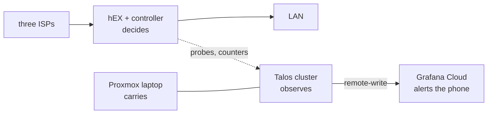

# Design

The whole system on one page: what it is for, what constrains it, how it is built, how its claims are checked, and what would change it. The other pages are the detail.

## Objective

I work from home, so the network is my work uplink first. The work tier has a usable path **99.9 %** of a rolling 30 days: about 43 minutes a month of error budget. Everything below is judged by what it does to that number ([indicator](home-network/docs/03-monitoring.md)).

## Constraints

| constraint | consequence |
|---|---|
| All three ISPs are behind CGNAT | nothing reaches in: deploys are pulled, and alerts leave over the links they report on |
| Two of the three share a pole | three providers, two physical failure domains |
| One 30 m gigabit trunk | aggregate capped near 940 Mbps; the switch, cable and hEX are single points of failure |
| Consumer lines, no SLA | recovery has to be ours, in seconds |
| One operator | the resting state must be safe, and a rebuild must come from git, not memory |

## Architecture

- **The router decides.** Devices are tiered by class (work, household, guest), each preferring one link. A controller on the hEX scores every link from nine port-443 probes and moves a tier off a dead link in about 2 s. It depends on nothing else in the house. Terraform.
- **The cluster observes.** Probe history, the event record, dashboards and alert rules. What must alert when the house is in trouble is remote-written to Grafana Cloud. Flux.
- **The host carries.** A ThinkPad running Proxmox, the two Talos VMs and the media disk. Ansible.

Dependencies point one way: losing the cluster loses visibility, never connectivity.

## Decisions that shaped it

1. **Three consumer lines, not one business line.** An SLA reaches a repair queue, not a pole. 34 % cheaper ([decisions](home-network/docs/05-decisions.md)).
2. **Tiers by device class, not load balancing.** A failure reads as one class having a bad time, and FastTrack stays on.
3. **Reputation, not up/down.** Lost in seconds, earned back over an hour, so a chronic fault like [ISP0's optics](home-network/docs/postmortems/isp0-optical-fault.md) never climbs back between blackouts.
4. **Decide on the router, observe in the cluster.** The controller survives everything above it.
5. **No tool owns the path it arrives on.** The router's management path and the host's network config are deliberately unmanaged, after a `destroy` nearly cut its own connection.

## How the claims are checked

| claim | check |
|---|---|
| ~2 s failover, calls survive | [drills](home-network/docs/07-runbooks.md) with a timing tool: 2.0 s twice |
| the scoring behaves as documented | a [port of the controller](home-network/tools/replay/controller.py) with regression tests for each incident, and a replay of recorded history |
| config applies | CI renders and validates every manifest, rule, Terraform unit and script on push |
| the objective is met | it is not: 96.2 % over 23 days, 99.77 % since 28 September ([measured](home-network/docs/03-monitoring.md)) |
| a rebuild works | bootstrap plus `apply` for the router, Terraform and Flux for the cluster, nightly backups with a restore runbook |

## Where the budget goes

Measured, the shared pole dominates: one cut spent 1,095 minutes, about 25 months of budget, so the mobile path comes first. A switch or hEX failure has not happened, but would spend months of budget in hours, so spares come next. What remains since 28 September is evening loss on all three links at once, not yet explained. Ranked in [Risks and next steps](home-network/docs/06-risks-and-next.md).

## What would change it

- **A mobile path for the work tier.** It becomes the real backup, and the third provider matters less.
- **The objective missed because of provider repair time**, not a shared pole: then a business line earns its price.
- **A second physical host:** an HA control plane and Talos on bare metal.
- **The replay showing reputation no better than probe state:** then the controller shrinks to up/down.
