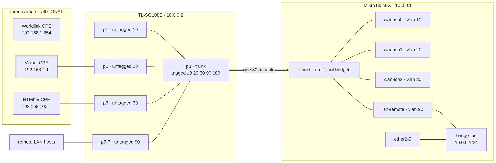

# Architecture

Three carriers reach one router over a single tagged trunk. This page covers the physical layout, the VLANs, the ISP links, CGNAT and shaping.

## Physical layout

The three ISP CPEs sit on the ground floor, outside the living space, so a technician can work on them without entering the house. The hEX, hypervisor and rack are upstairs behind a door, about **30 m** of cable away. Three cables were never realistic, so **one gigabit cable** carries everything and each ISP becomes a VLAN tag.

The switch must sit with the CPEs, so it carries LAN ports outside the house. It is behind a lock.

The trunk is the throughput ceiling. The three lines sum to 1,200 Mbps (1,000 from 2 November) and share one gigabit link that also carries the remote LAN, so the aggregate cannot exceed about **940 Mbps**.



## VLANs

| VLAN | carries | on the hEX |
|---|---|---|
| 10 | ISP0 Worldlink (switch port 1) | `wan-isp0` |
| 20 | ISP1 Vianet (port 2) | `wan-isp1` |
| 30 | ISP2 NTFiber (port 3) | `wan-isp2` |
| 40 | reserved | not terminated |
| 90 | remote LAN (ports 5–7) | `lan-remote`, bridged into `bridge-lan` |
| 100 | switch management | not terminated |

`ether1` is a pure trunk: no IP, not in any bridge, and in the **WAN** interface list. The switch's management CPU answers on the trunk, so it is treated as untrusted and the input chain drops it.

## ISP links

| slot | provider | line | shaped at | CPE | CPE hands us |
|---|---|---|---|---|---|
| ISP0 | Worldlink | 600 / 300 | 570M / 279M | `192.168.1.254` | `192.168.1.x` by DHCP |
| ISP1 | Vianet | 400 / 200 | 380M / 186M | `192.168.2.1` | `192.168.2.2` static |
| ISP2 | NTFiber | 200 / 100 | 190M / 95M | `192.168.100.1` | `192.168.100.x` by DHCP |

- ISP0 drops to 400 / 200 on 2 November 2026. On that date the controller's `caps` and the queue limits in `queues.tf` change together.
- ISP1's CPE never answers DHCP (nine DISCOVERs over 24 s, no reply), so its address is static.
- Every DHCP client runs with `add-default-route=no`. A lease-installed route would fight the controller for route distance, the one attribute it owns.

## CGNAT

All three links are behind carrier NAT (confirmed 5 October 2026). **No inbound port forwarding exists on any link**; anything reachable from outside is an outbound tunnel.

Traceroute hides this. Over Worldlink and Vianet the hop after the CPE is public (202.166.192.2, 43.245.84.97), but the shared address is on the CPE's WAN side, and the NAT step never answers a trace. Only NTFiber shows it, because its first router is private (10.133.0.1).

To check a link, compare the CPE's WAN address on its status page with the address seen over that link:

```
curl -s https://ifconfig.me
```

Different addresses mean carrier NAT. To trace one link from the router, target one of its probe pins (RouterOS v7 has no `routing-table=` on traceroute):

```
/tool/traceroute 8.8.8.8          # ISP0
/tool/traceroute 8.8.4.4          # ISP1
/tool/traceroute 208.67.220.220   # ISP2
```

## Shaping

Each link is shaped at 93–95% of line rate so the queue forms on the hEX, where fq_codel can schedule it. If the bottleneck sits in the ISP's buffer, the bufferbloat happens upstream, out of reach.
