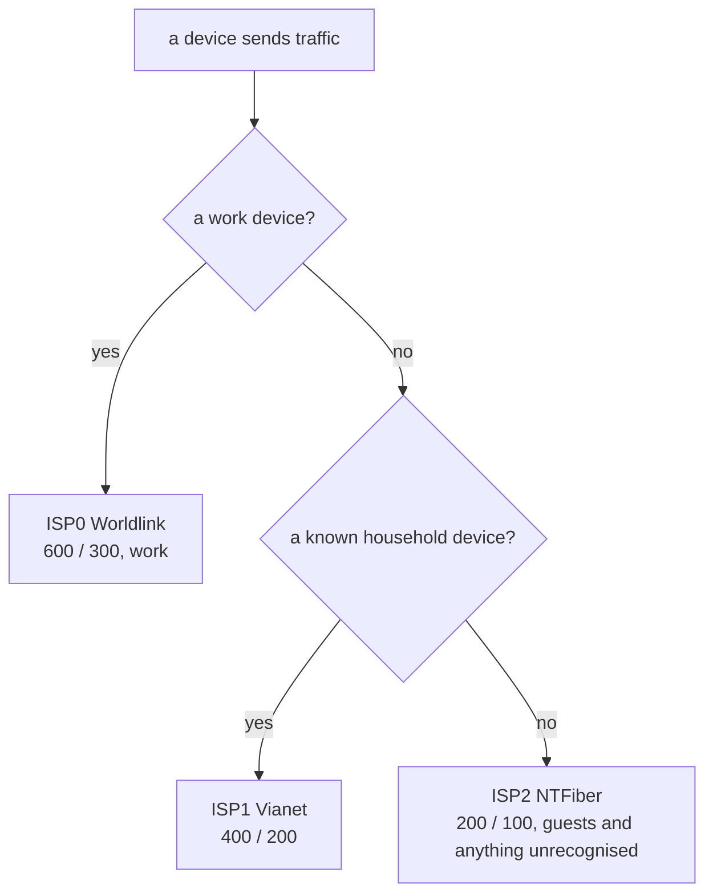
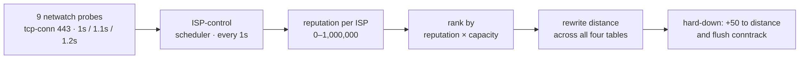

# Routing and failover

How traffic is assigned to links, how the controller moves it, and what a failover costs. The drill procedures are in [Runbooks](07-runbooks.md).

## Device tiers

No per-flow load balancing. Each device class prefers one link, selected by source address alone. This needs no packet inspection, and a failure reads as "the work machine is having a bad time" instead of a random mix of broken connections.

| class | matches | link |
|---|---|---|
| infrastructure | the router itself, LAN-local traffic, the three CPE subnets | stays local (`main`) |
| work | pve, the wired Macs, the `10.0.0.16/28` block | ISP0 |
| guest | `10.0.0.160/27`, the dynamic pool | ISP2 |
| household | everything else in the `/24` | ISP1 |

- **Order is enforced.** The household rule matches the whole subnet, so anything after it is dead configuration. Infrastructure goes first so the CPEs stay reachable and the router's own DNS and NTP follow the global primary.
- **Guests are not a list.** `10.0.0.160/27` is the only dynamic DHCP range; every known device has a reservation outside it, so unknown means guest. The reservations in [`addressing.tf`](../terraform/addressing.tf) are part of the routing.
- **MAC randomisation must be off** on known devices, or they lose their reservation and land in the guest pool.
- **The Kubernetes nodes** (10.0.0.20 and .21) are in the work block, so all cluster egress (image pulls, metrics, Jellyfin metadata) rides ISP0.
- **Downloads are the exception.** qBittorrent leaves from its own address, 10.0.0.11, split across ISP1 and ISP2 and never ISP0. See [Decisions](05-decisions.md).

Every table carries all three links, so a tier prefers a link without being pinned to it:

| table | 1st | 2nd | 3rd |
|---|---|---|---|
| `main` | follows the global primary | | |
| `via-isp0` (work) | ISP0 | ISP1 | ISP2 |
| `via-isp1` (household) | ISP1 | ISP0 | ISP2 |
| `via-isp2` (guest) | ISP2 | ISP0 | ISP1 |

The cost: during the [pole cut](postmortems/pole-cut.md) every tier ended up on ISP0 together.

## Control loop

Netwatch only measures; every decision lives in one scheduler-driven script, [`isp-control.src`](../terraform/scripts/isp-control.src) (netwatch-invoked scripts cannot persist `:global` state; see [the postmortem](postmortems/controller-never-decided.md)). Probes are described in [Monitoring](03-monitoring.md).

The script runs every second but only checks the fast path: if all of a link's probes are down, demote it. Scoring runs every tenth pass, so a **tick** is 10 s. Leaving a dead link is immediate; moving to a better one is damped.

| mechanism | rule |
|---|---|
| Reputation | asymmetric moving average, 0–1,000,000: each tick moves 30% toward a worse sample, 0.5% toward a better one. Weights severity, so a 12-minute blackout is not washed out within the hour |
| Tier hysteresis | a tier yields its link below 500k and reclaims it above 800k. No separate timer |
| Primary hold | a new global primary on quality grounds needs a 110% margin held for 15 minutes. Failover off a dead primary skips both |
| Fallback | ranking is reputation × capacity, but a link that has yielded its tier ranks below every link that hasn't. On 27 September ISP0 at 32% outranked ISP2 at 97% two minutes before failing again; this rule fixed that. `main` likewise leaves a yielded primary after the usual hold |

The constants (30% / 0.5%, 500k / 800k, 110%) were reasoned from one night's data. [`tools/replay`](../tools/replay/replay.py) replays recorded probe history through a port of the scoring and compares it with probe state alone; its tests pin the return times below. Over the 5-minute history (19 September to 14 October) the controller put the work tier on a lossy link 1 to 3 % less often than probe state alone, while spending about three and a half hours in total off a clean ISP0. At that resolution it is inconclusive, so the constants stand.

## Measured failover

Expected: about **2 s**, **3 s** worst case: one probe interval (1.2 s) plus the 0.5 s timeout plus one 1 s controller pass. Before 28 September (10 s probes, 3 s timeout, 10 s controller) the expectation was 5 / 13 / 23 s.

Four ISP0 drills so far. The first two missed the target (14.6 s and 27.4 s, both calls dropped); the last two, after the probe and controller changes on 28 September, measured **2.0 s** with the call surviving both times. Full results and per-run notes are in the [runbooks](07-runbooks.md), where the drill tool writes them.

Return time scales with the outage: a one-tick blip leaves reputation near 700k and returns in about 15 min (ISP1, 26 September: 13½); 90 s down leaves about 30k and needs about 50 min. The 15-minute primary hold adds on top.

### What a failover costs, by activity

Each link has its own CGNAT address, so failover changes the public address and the conntrack flush ends existing connections. Faster detection cannot help.

| activity | what a 2-second failover does |
|---|---|
| video call | a brief audio glitch, then the client reconnects. Survives, demonstrated 2026-09-28 |
| web browsing | a request in flight fails; a reload works. Usually unnoticed |
| video streaming | nothing. The buffer is tens of seconds and new segments open new connections |
| large download | breaks. Resumes if the client uses range requests, restarts if not |
| **SSH** | **dies.** A long-lived TCP session cannot survive its source address changing |
| VPN to work | drops, then reconnects by itself, usually in seconds |
| qBittorrent downloads | nothing meaningful; they rebuild peer connections continuously anyway |

Use `mosh` instead of `ssh` for long-running sessions; it is UDP and roams across address changes. The only fix for the changing address is an overlay tunnel to a fixed endpoint; see [Risks and next steps](06-risks-and-next.md).
