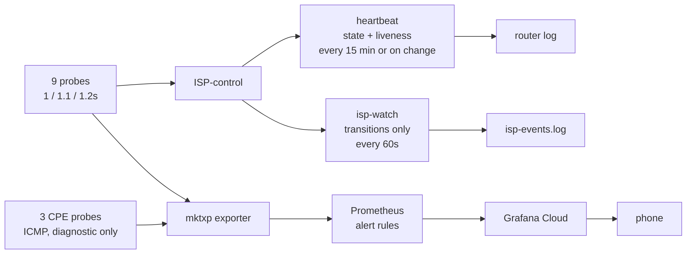

# Monitoring

What is probed, what the instruments cannot see, and how a failure reaches a person. Response steps for each alert are in [Runbooks](07-runbooks.md).

## Link probes

Nine netwatch `tcp-conn` probes on port 443, three per link on three different operators. A link is scored down only when all three agree.

| link | 1s | 1.1s | 1.2s |
|---|---|---|---|
| ISP0 | `8.8.8.8` Google | `76.76.2.0` ControlD | `1.1.1.2` Cloudflare |
| ISP1 | `8.8.4.4` Google | `45.90.28.0` NextDNS | `1.0.0.2` Cloudflare |
| ISP2 | `208.67.220.220` OpenDNS | `194.242.2.2` Mullvad | `1.1.1.3` Cloudflare |

| rule | why |
|---|---|
| Port 443 instead of ICMP | carriers deprioritise and police ping, so ICMP loss does not mean traffic loss |
| Nine distinct targets | probes are pinned by destination, and a destination routes through only one table |
| No configured resolver is a target | pins use `lookup-only-in-table` with no fallthrough; pinning `1.1.1.1` would take DNS down with its link |
| Targets must absorb the load | 72,000–86,000 connections a day per target. AdGuard read 0.1–0.3% worse on every link; SafeDNS refuses 443; Yandex reset 6 of 8 connections in a burst. Measure every target before adopting it |
| Staggered intervals (1 / 1.1 / 1.2 s) | netwatch has no phase offset; same-interval probes fire together, so one router stall fakes a link failure (seen twice on 27 September). 1 s is netwatch's floor |
| The 1 s slot goes to a large international target | loss is pooled per link, so the most frequent probe carries the most weight; it should test the path the work traffic takes |
| One domestic probe, slowest slot | Cloudflare and Quad9 terminate at Kathmandu peering; Google crosses to India. Two of three cross transit because the work services are abroad; the domestic one separates "link dead" from "transit dead" |

Netwatch thresholds are set per target, because targets differ by 60× (Cloudflare 1.6 ms, OpenDNS 98 ms). A threshold breach sets `status=down`, so latency without loss (20 ms to 800 ms, every connect still completing) is scored exactly like failure.

## Objective

The [target](../README.md) is 99.9 % over 30 days, all hours: the work services are abroad, so there are no off hours to exclude.

**Indicator:** the share of 5-minute windows in which at least one link lost under 1 % of its probes. A link gets about 820 probes a window, so 1 % is roughly 3 s of total loss. The work tier fails over in about 2 s, so a bad window means no link was good enough to move to.

| does not count | why |
|---|---|
| the 2 s failover gap | its cost is per activity, in [Routing and failover](02-routing-and-failover.md) |
| loss under 1 % on the best link | below what a call notices |
| windows with no samples | the sampler runs in the cluster and reads the router, so a dead hEX, trunk or cluster records nothing. Total outages are under-reported until something outside the house measures them |

From Prometheus (`isp:link_loss_ratio5m`, counter-based):

```
avg_over_time((min(isp:link_loss_ratio5m) < bool 0.01)[30d:5m])
```

From the full history, which predates the current Prometheus. Rotated copies are gzipped and have no header, so copy the directory out rather than `cat` it:

```sh
mkdir -p /tmp/isp && kubectl -n homenet exec deploy/dash-agent -- tar cf - -C /data log | tar xf - -C /tmp/isp
python3 home-network/tools/replay/replay.py --csv /tmp/isp/log/isp-history.csv*
```

The first line it prints is the indicator over the whole record.

**Measured** from `isp-history.csv`, 19 September to 14 October 2026:

| period | indicator | without a good link |
|---|---|---|
| whole record, 23.4 days | 96.17 % | 1,290 min |
| [pole cut](postmortems/pole-cut.md), 23–26 Sep | 73.2 % | 1,095 min |
| since the 28 Sep probe and controller changes, 14.8 days | 99.77 % | 50 min, about 100 a month |

Since 28 September the misses are two kinds. ISP1 and ISP2 failing together (9 October, 22 minutes, with two one-minute ISP0 blips inside it), and all three links losing 2–5 % at once, always between 17:00 and 21:30 Kathmandu. Three unrelated carriers degrading together points at something they share: the hEX, international transit, or probe timeouts tripping on evening latency. Not yet separated. The record has 40 hours of gaps, which count as neither good nor bad.

## CPE probes

Three ICMP probes every 10 s to the CPEs: `192.168.1.254`, `192.168.2.1`, `192.168.100.1`. They are diagnostic only: no `down_script`, a comment the controller does not match, and excluded from alert rules.

| CPE probe | link probes | means |
|---|---|---|
| up | failing | the carrier |
| down | failing | the box downstairs, or the route to it |

They exist because the September ISP1 outages were the hEX losing its route to `192.168.2.1`, one hop away. ICMP is used because `tcp-conn` is impossible on two of three (29 September: ISP1's CPE serves no TCP from the LAN side; ISP2's refuses 443).

## Blind spots

- `rtt_max` is the slowest of three probes, one international. It reports geography rather than queue delay and cannot detect bufferbloat.
- The `jitter` column is spread between three operators; it does not measure link jitter.
- Throughput sampling can report impossible values (712 Mbps on a 400 Mbps line) when two samples land seconds apart. It has no elapsed-interval guard yet.
- A SYN lost inside the 500 ms timeout is not retransmitted, so chronic loss reaches reputation as a failure ratio.

## Counters over gauges

`mktxp_netwatch_info` is a gauge scraped every 30 s. On 28 September the router logged six whole-link ISP1 outages of about 7 s each, and none appeared in Grafana: every one fell between scrapes. Scraping faster does not fix it; the shortest event is one lost handshake, about 1 s.

Alerting and history use netwatch's cumulative `done-tests` and `failed-tests` per probe instead. A 7 s outage is `+1 failed` at any scrape interval. The controller also counts its hard-downs, failovers and yield transitions, because the router log holds only about seven hours. Nothing collects those yet: the REST API cannot read script globals.

Rule: compare an instrument's resolution against the event itself, and prefer one that integrates over one that samples.

## Notification path

Liveness, events and alerts are kept separate.



**Heartbeat**, from the controller every 15 minutes or on change:

```
ISP-control ENFORCE rep=1000/700/1000 loss=0/1000/0 up=3/0/3
            yield=010 primary=ISP0 tick=29 flush:ISP1@192.168.2.2
```

Fields: reputation (thousands), loss, probes up, yielded links, primary, and this tick's actions. Check for `ENFORCE`: during the [failover-off outage](postmortems/failover-off-after-reboot.md) the line read `SHADOW` and was otherwise identical.

**Events**, from `isp-watch` on transitions only. It holds just the previous state and is separate from `isp-log.sh`, the five-minute sampler that keeps loss history.

| severity | emitted for |
|---|---|
| `CRIT` | all WANs down · only one healthy left · controller not enforcing · controller stalled |
| `WARN` | a link down · router rebooted |
| `INFO` | link recovered · redundancy restored |

## Alerts

Prometheus evaluates; Grafana Cloud delivers to the phone. Added after ISP2 was down nearly four hours on 23 September before anyone noticed ([pole cut](postmortems/pole-cut.md)).

| alert | fires when | why it exists |
|---|---|---|
| `ISPDown` | all three probes on a link fail for 2 min | three independent operators, so it is the path, not one responder |
| `ISPDegraded` | 1–2 of 3 probes up for 10 min | one operator may simply be unreachable; worth knowing, not worth waking for |
| `NoRedundancy` | one healthy link or fewer, for 5 min | one link left is not an outage, so nothing else reports it; but the next failure *is* one |
| `AllWANsDown` | no healthy link for 2 min | |
| `RouterUnreachable` | the exporter cannot reach the hEX for 3 min | otherwise a dead exporter looks identical to a total outage |
| `ControllerNotEnforcing` | the heartbeat says `SHADOW` for 2 min | failover is off and every other signal looks healthy ([postmortem](postmortems/failover-off-after-reboot.md)) |
| `ControllerStalled` | the run-count has not moved for 5 min | routes stay where they were |
| `ControllerUnobserved` | nothing has read the controller, or no heartbeat was found, for 20 min | the two above are blind; "cannot tell" must never page as "failover off" |

The controller rows come from `isp-watch`'s state, republished by `dash-agent` at `/metrics` and recorded as `isp:controller_*`.

**Warning:** the exporter reports netwatch as an info metric with up/down in a label. When every probe on a link fails, the "up" series disappears instead of reading zero, so an alert on `== 0` goes silent exactly when needed. The recording rule supplies an explicit zero from the full probe set.

`AllWANsDown` cannot deliver itself, since it is true only when Grafana Cloud is unreachable. A total outage shows there only as data stopping. That gap is open; see [Risks and next steps](06-risks-and-next.md).
