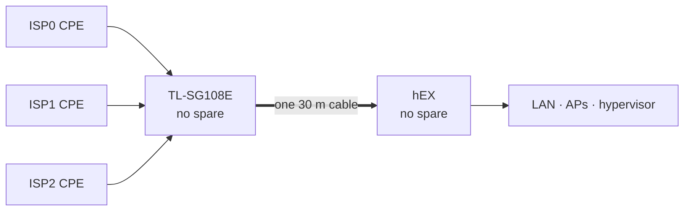

# Risks and next steps

House-side failure domains, non-goals, and next steps.

## Own failure domains

Three providers converge on one switch, one cable and one router: one house-side path.

| domain | status | cover |
|---|---|---|
| grid power | **mitigated** | every device in the path has its own mini DC UPS: each ONT, the switch, the hEX, each AP |
| a single UPS failing | **contained** | one battery per device; a failed unit takes out one device |
| provider side in a power cut | **the provider's** | GPON street fibre and splitters are passive; only the exchange needs power |
| the hEX | **accepted** | no spare. Recovery is a replacement, the [bootstrap](../terraform/README.md#the-bootstrap), then `apply`, which works offline from the local provider mirror |
| the switch | **accepted** | no spare. It carries all three providers, so failure is a total outage. Config is in [Runbooks](07-runbooks.md) |
| the 30 m trunk | **accepted** | one cable; a second run was ruled out on distance |
| physical access to the switch | **mitigated** | it carries LAN ports outside the house; it is locked |
| the operator | **accepted** | one person understands the controller, Terraform and monitoring |
| alerting during a total outage | **open** | alerts leave over the links they report on; a total outage shows only as data stopping at Grafana Cloud, via an untested no-data alert |

The hEX, switch and cable are accepted on likelihood: they are indoor, powered and rarely touched, and the providers' domains are where failures have actually happened. On impact they are the worst rows: each is a total outage until replaced.

### UPS runtime (estimates)

- Units are rated 17 W with an 8,800 mAh pack, about 27 Wh after conversion: roughly 5½ h at 5 W, 2¼ h at 12 W.
- The hungriest device sets runtime. The network lasts as long as the shortest battery among the switch, the hEX and at least one ONT; a Wi-Fi 6 ONT or AP runs out first.
- Changeover is a vendor claim. Cheap DC UPS units can dip and reboot what's attached; the event watcher flags the hEX's uptime going backwards.
- Lithium packs held at full charge lose capacity within a year or two. Test yearly.

Estimates until the [power drill](07-runbooks.md) runs.

### The operator

- Failover, return, tiering and alerting need nobody; novel faults, hardware and provider swaps wait for the operator. The [operator-absent drill](07-runbooks.md) tests whether someone else can get the house back online.
- The resting state is safe: the controller enforces after reboot, so anyone can power-cycle the router.
- A rebuild is the bootstrap plus `apply`; nothing relies on memory.
- Each CPE keeps its Wi-Fi on, bypassing the switch, cable, hEX and operator.

## Non-goals

- **More than ~940 Mbps aggregate.** The single gigabit trunk caps it; that keeps technicians out of the house.
- **Inbound services.** All three links are behind CGNAT.
- **Per-flow load balancing.** Downloads are the one exception. See [Decisions](05-decisions.md).
- **A business-grade SLA.** It buys a faster queue, not a second physical path.

## Next, ranked by error budget

The [objective](../README.md) allows about 43 minutes a month without a usable path. Ranked by how much of that each item protects:

1. **Mobile data path for the work tier.** The only domain sharing nothing with the others: no pole, fibre, switch or trunk. Measured: the [pole cut](postmortems/pole-cut.md) alone cost 1,095 minutes, 85 % of the shortfall and about 25 months of budget, and the shared pole failed again for 22 minutes on 9 October.
2. **A spare switch, then a spare hEX.** Neither has failed, but either is a total outage until a replacement is bought and configured: two hours spends almost three months of budget. The switch costs a few months of one line.
3. **Find the evening loss.** Since 28 September most misses are all three links losing 2–5 % together at evening peak ([Monitoring](03-monitoring.md)). Per-target loss separates the hEX, international transit and probe timeouts.
4. **Alert on burn rate** from `isp:link_loss_ratio5m`, now that the budget is measured.
5. **The total-outage drill.** The only check that a total outage reaches anyone is Grafana Cloud noticing data stop, and it is untested.
6. **Finish the failover drills.** Four ISP0 runs done (2.0 s, call survived twice). Left: the other two links, a deliberate double failure, and whether losing ISP0 disturbs ISP1.
7. **Replay at 30 s resolution** from Grafana Cloud. At the CSV's 5 minutes the replay is inconclusive ([Routing and failover](02-routing-and-failover.md)).
8. **Power drill.** Pull mains, time each UPS, check the hEX's uptime.
9. **A provider scorecard.** Reputation, dropouts per day and support outcomes per slot over a term, for the next [exit decision](05-decisions.md).
