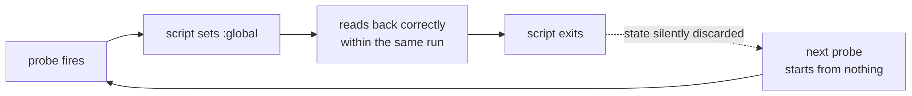

# The controller that never decided

The first failover controller ran inside netwatch's `up-script` and `down-script`. It ran for days, producing plausible log output, without ever making a decision.

| | |
|---|---|
| Date | First controller version (before the scheduler rewrite) |
| Duration | Several days |
| Impact | No quality-based routing decisions; all controller state reset on every probe |
| Detection | I noticed state never changed; no alert |
| Root cause | Scripts invoked by netwatch cannot persist `:global` variables |

## Timeline

| When | What |
|---|---|
| Day 0 | Controller deployed as netwatch up/down scripts |
| Days 0–n | Nine probes tick every ten seconds; log looks healthy |
| Day n | I notice no decision has ever been made; trace it to `:global` not persisting |
| Fix | All state moved into one scheduler-driven script |

## What happened

In a netwatch-invoked script, a `:global` assignment succeeds and reads back correctly within the run. By the next invocation it is gone. Every reputation, sample and hold timer reset on each probe. RouterOS documentation does not mention this; scheduler-run scripts persist globals normally.

## What changed

- One scheduler-driven script owns all controller state; netwatch only probes: [Routing and failover](../02-routing-and-failover.md).

## Lessons

- Log output does not prove the controller works. The test is whether its state changed.
