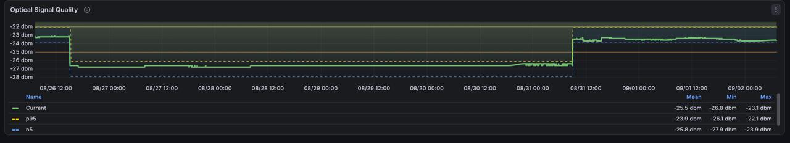
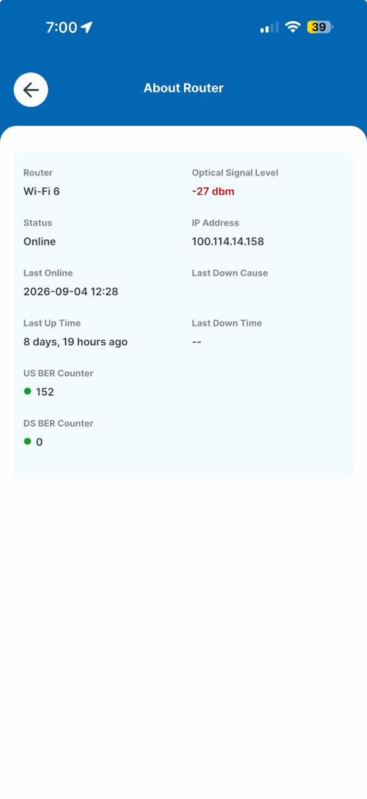
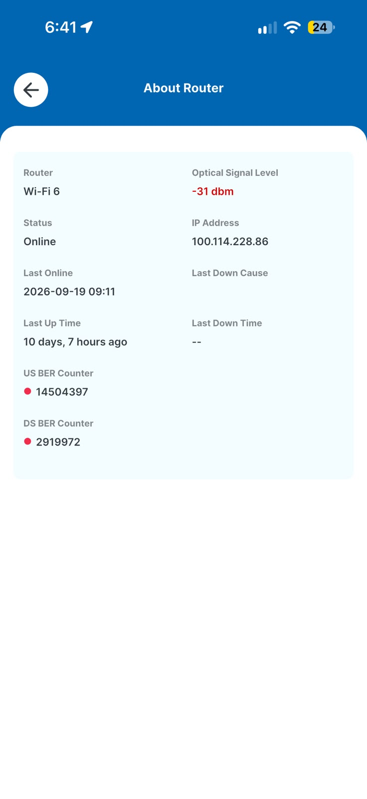

# ISP0 optical fault

Worldlink's drop to this address was installed at the GPON rated receive limit and stayed there, with excursions well past it, for eight weeks. The link was flawless for long stretches and then vanished outright. It was fixed when the drop was moved to the area's newer distribution box on 20 September.

| | |
|---|---|
| Date | 27 Jul to 20 Sep 2026 |
| Duration | About eight weeks |
| Impact | ISP0 (Worldlink, then the only line) dropped out repeatedly: 2.42 % mean loss overnight, dozens of complete dropouts a day by 24–25 Sep |
| Detection | Prometheus exporter on the ONT ([`ont-exporter`](https://github.com/thapabishwa/ont-exporter)), then per-ISP probes |
| Root cause | Drop run from the area's older distribution box; a mechanical fault (connector, splice or bend) switching between two optical states |

## Timeline

| When | What |
|---|---|
| 27 Jul | Moved in. Worldlink's installers measure **-27 dBm** at connection and leave it. The same service read about **-13 dBm** at the previous address. |
| Late Jul | Fault reported in person at Worldlink's office. No response. |
| Aug–Sep | Reported repeatedly. Each visit a temporary patch; the fault back within one or two days. |
| 26 Aug | ONT exporter running. Receive power steps from about -23 to **-26.8 dBm** within minutes. |
| 31 Aug | Steps back to about -23.5 dBm. |
| 4 Sep | Provider's app reads -27 dBm. |
| 10 Sep | NTFiber activated as a second line (fibre already in place). |
| 18 Sep | Vianet installed. |
| 19 Sep | Provider's app reads **-31 dBm**. |
| 20 Sep | At my request, Worldlink moves the drop to the newer distribution box. About **-17 dBm**. |
| 23 Sep | Both new lines lost to a [pole cut](pole-cut.md); Worldlink carries the house. |

## What happened

The ONT is a Nokia G-1426G-A. I wrote an exporter for it (40+ metrics) to get one number: PON optical receive power. It moved in steps:



A 3.8 dB drop in minutes, held for four and a half days, is not temperature drift. Something in the path switched between two states. The provider's own app, which coloured both readings red, showed worse:

| Provider app | Optical level | Upstream BER counter | Downstream BER counter |
|---|---|---|---|
| 4 Sep | -27 dBm | 152 | 0 |
| 19 Sep | **-31 dBm** | **14,504,397** | **2,919,972** |




GPON Class B+ optics are rated to receive down to **-27 dBm** (ITU-T G.984.2 Amd 1).

```
  -8 dBm  ┤ overload limit
          │
 -13 dBm  ┤ ●  the previous address: Worldlink worked fine here
          │
 -23 dBm  ┤ ●  this address, the good weeks
          │
 -26.8    ┤ ●  26–31 August, four and a half days   ← 0.2 dB of margin
 -27 dBm  ┤ ─────────── rated sensitivity (Class B+) ───────────
          │
 -31 dBm  ┤ ●  the provider's own app, error counters in the millions
```

Past the limit, FEC hides errors until it can't; then frames are lost or the ONT re-registers. The link does not slow down. It disappears and comes back.

| Measured overnight, 119 samples per ISP | ISP0 |
|---|---|
| Mean loss | **2.42 %** |
| Intervals above 5 % loss | **11 of 12** |
| Worst | Complete blackout, 05:53 to 06:05 |
| Lifetime | 226 of 9858 probes failed |

Same period: ISP1 0.34 % mean, one interval above 5 %; ISP2 0.00 %, zero failures in 9858. The link was idle (0 Mbps) during its worst intervals, which rules out congestion.

For escalation, a timestamped list of dropouts was harder to argue with than a loss percentage:

```sh
kubectl -n homenet exec deploy/dash-agent -- cat /data/log/isp-events.log \
  | awk '/ISP0 DOWN/{split($1,d,"T"); c[d[1]]++} END{for(k in c) print k, c[k]}' | sort
```

The repair (moving the drop to the newer box) was my suggestion; it did not come from the provider's diagnosis. Since then ISP0 loses a few minutes a day at most, in brief blips.

### Follow-up: ISP1 became the worst link

Eight days after the repair, lifetime failed-probe rates had inverted:

| | Failed probes, lifetime |
|---|---|
| ISP0 Worldlink | **0.15 %** |
| ISP1 Vianet | **2.05 %** |
| ISP2 NTFiber | 1.72 % |

On 28 Sep ISP1 lost every probe six separate times, the longest for **6m47s**. It shows as the hEX losing its route to `192.168.2.1`, one hop away on this side of the trunk. The probes had at first recorded those failures as successes, because I had not checked what the error strings meant. Details are in [Monitoring](../03-monitoring.md).

## What changed

- Two more providers on the same trunk with automatic failover: [Architecture](../01-architecture.md), [Routing and failover](../02-routing-and-failover.md).
- ONT optical power and per-ISP probes as permanent telemetry: [Monitoring](../03-monitoring.md).
- Scoring weights severity rather than counting incidents, because the mean hides "flawless, then gone": [Routing and failover](../02-routing-and-failover.md).

## Lessons

- Good evidence (the provider's own readings, a rated limit, a mechanism, a time series) still got only patches for eight weeks. The real repair came on the provider's schedule, after the backup lines were in.
- An instrument built for one fault can find the next, provided someone checks it still measures what it seems to.
