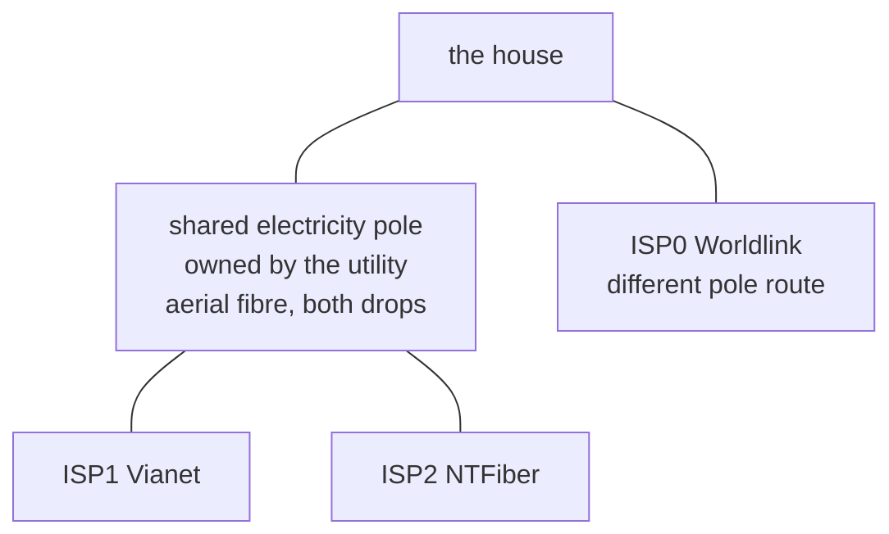
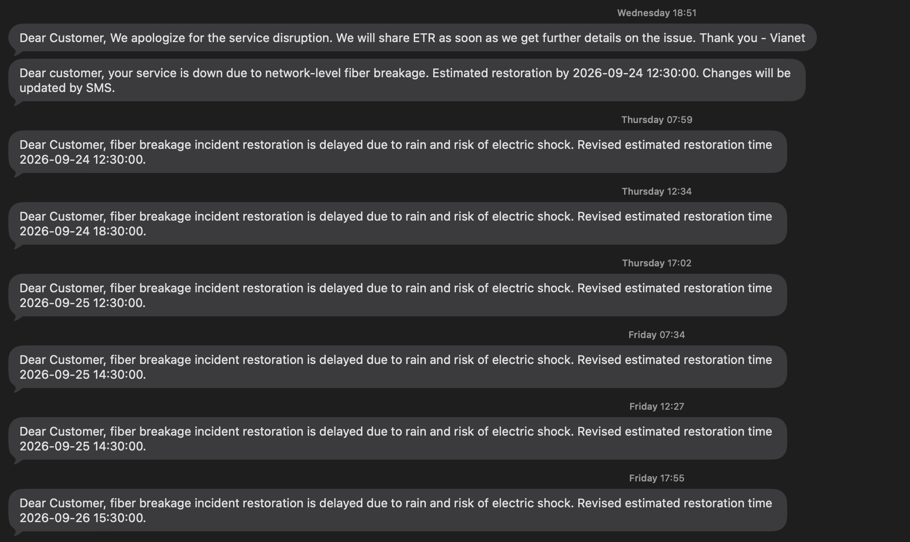

# Pole cut: two ISPs down for 64 hours

The fibre for Vianet and NTFiber shares one utility pole, and the pole's drops were cut deliberately when it became unsafe. Both lines were down together for 64 hours. Worldlink, on a different pole route and repaired only three days earlier, carried the house alone.

| | |
|---|---|
| Date | 23–26 Sep 2026 |
| Duration | NTFiber **67 h**, Vianet **65 h**, overlap **64 h** (23 Sep 17:35 to 26 Sep 09:43) |
| Impact | Single-link operation on ISP0, still blipping dozens of times a day after its [optical fault](isp0-optical-fault.md). Failover worked and had nowhere to go. |
| Detection | The probes saw it at once, but nothing paged: ISP2 was down nearly four hours before I knew, and then only from Vianet's SMS about its own outage |
| Root cause | Two providers' aerial drops on the same utility-owned pole, cut as part of making the pole safe; restoration blocked by monsoon rain |

## Timeline

| When | What |
|---|---|
| 23 Sep 15:05 | ISP2 NTFiber down |
| 23 Sep 17:35 | ISP1 Vianet down. Single-link operation begins. |
| 23 Sep 18:51 | Vianet acknowledges by SMS (76 minutes). This is how I learn of the outage, including NTFiber's, nearly four hours in |
| 23–26 Sep | Seven restoration estimates, six missed; each cites rain and risk of electric shock |
| 26 Sep 09:43 | NTFiber restored |
| 26 Sep 11:04 | Vianet restored, 4.4 h ahead of its final estimate |

## What happened

Last-mile fibre here is strung on power distribution poles. Vianet and NTFiber are unrelated companies with different equipment and upstreams, but their drops hang on the same pole. The utility owns it, has no contract with me or either ISP, and takes every carrier down with the pole on its own schedule.

Three providers, **two failure domains**. No diagram, traceroute or contract shows this.

| Sent | Promised | Lead | Outcome |
|---|---|---|---|
| Wed 18:51 | Thu 12:30 | 17.6 h | missed |
| Thu 07:59 | Thu 12:30 | 4.5 h | missed |
| Thu 12:34 | Thu 18:30 | 5.9 h | missed |
| Thu 17:02 | Fri 12:30 | 19.5 h | missed |
| Fri 07:34 | Fri 14:30 | 6.9 h | missed |
| Fri 12:27 | Fri 14:30 | 2.0 h | missed |
| Fri 17:55 | **Sat 15:30** | 21.6 h | **beaten by 4.4 h** |

Four of the six revisions arrived before the deadline they replaced, about twice a day. The estimates worked as a heartbeat (still here, still blocked, same cause) and carried liveness, not timing. "Still blocked, next update 18:00" would have cost no trust. This network's [notifications](../03-monitoring.md) keep liveness and events separate for the same reason.

Vianet acknowledged within 76 minutes, gave a real cause, kept a steady cadence and beat its final estimate. The delay was weather and a safety rule.

### Why a business line would not have helped

Three residential lines cost **~Rs 48,600/yr** (1,000 Mbps total). Worldlink's Biz24 Grow (300–600 Mbps) costs **Rs 73,450/yr**, so the three lines are **about 34 % cheaper**. Neither publishes an uptime or restoration figure. A Vianet or NTFiber business plan runs on the same pole and would have been cut the same way. The repair chain was ISP queue, then the utility making the pole safe, then the weather. An SLA reaches the repair queue, not the pole or the weather. Full comparison: [Decisions](../05-decisions.md).

## What changed

- Alerts now reach a phone, and `NoRedundancy` fires when one healthy link is left: [Monitoring](../03-monitoring.md).
- The shared pole is recorded as a failure domain: [Risks and next steps](../06-risks-and-next.md).
- A new provider counts only if its fibre arrives on a different pole route: [Decisions](../05-decisions.md).

## Lessons

- Adding a provider on an existing pole route adds bills, not independence. Availability is bounded by physical paths.
- Failure domains on shared physical infrastructure are found by looking up at the pole, or by losing two providers within hours.
