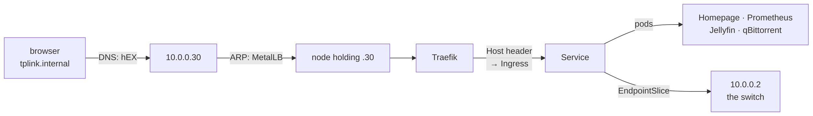
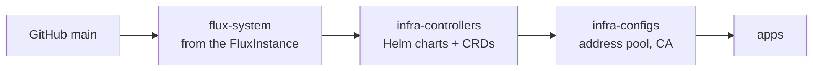

# Architecture

Two Talos VMs on the Proxmox laptop, deployed by Flux from this repository. This page covers the nodes, what runs where, and how a change reaches the cluster.

## Nodes

| Node | VM | Address | vCPU | RAM | Disk |
|---|---|---|---|---|---|
| `talos-cp-1` (control plane) | 110 | 10.0.0.20 | 2 | 8 GiB | 20 GiB |
| `talos-w-1` (worker) | 111 | 10.0.0.21 | 4 | 16 GiB | 40 GiB |

- The API is `https://k8s.internal:6443`, the control plane's own address. With one control plane there is nothing for a floating address to float between.
- **Talos**: the OS is an API and a config file, with no SSH or package manager, so nothing can drift by hand.
- **VMs**, because Kubernetes on the Proxmox host fights its networking and firewall, and inside LXC it needs privileged containers.
- Two nodes make scheduling, draining and upgrades behave normally. Both share one failure domain, the laptop.

## What runs where

| | Where | Name |
|---|---|---|
| Homepage | cluster | https://home.internal |
| dashboard feeds, ISP watcher and sampler | cluster, `homenet` | http://dash.internal |
| Proxmox UI | pve, proxied | https://proxmox.internal |
| Jellyfin | cluster, `media` | http(s)://jellyfin.internal, http://10.0.0.10:8096 |
| qBittorrent | cluster, `media` | https://qbit.internal, http://10.0.0.11:8090 |
| switch UI | the switch, proxied | https://tplink.internal |
| Prometheus (via the Prometheus Operator), mktxp, blackbox | cluster, `monitoring` | https://prometheus.internal, not from the guest pool; ISP alerts go to Grafana Cloud |
| Grafana | cluster, `monitoring` | https://grafana.internal, not from the guest pool |
| household CA certificate | cluster, `ca` | http://ca.internal |
| Flux web UI | cluster, `flux-system` | https://flux.internal (read-only) |

## A request, end to end



Details: [Networking](02-networking.md) and [TLS](03-tls.md).

## GitOps with Flux

Flux runs in the cluster, checks the repository every minute and applies `main`. It reads GitHub with a read-only deploy key (the `flux-system` Secret). Secrets are committed encrypted with SOPS ([State and secrets](06-state-and-secrets.md)).

Flux itself is one `FluxInstance` ([`clusters/home/flux-instance.yaml`](../clusters/home/flux-instance.yaml)), reconciled by the Flux Operator; Flux in turn installs and upgrades the operator (`infrastructure/controllers/flux-operator`).

The operator serves the **Flux web UI** at https://flux.internal: every Kustomization, HelmRelease and source, with events and inventory. With no login configured it is read-only: Secrets and ConfigMaps are hidden and reconcile/suspend are disabled.

## Layout and order

```
kubernetes/
  clusters/home/           Flux's entry point
    flux-instance.yaml     Flux itself, reconciled by the Flux Operator
    infrastructure.yaml    two Kustomizations: controllers, then configs
    apps.yaml              depends on configs
  infrastructure/
    controllers/           Flux Operator, MetalLB, Traefik, cert-manager,
                           local-path-provisioner, metrics-server,
                           kubelet-serving-cert-approver, Multus,
                           the Prometheus Operator's CRDs
    configs/               MetalLB's address pools, the private CA
  apps/                    ca, homepage, homenet, lan-proxy, media,
                           monitoring
  images/homenet-agent/    built by .github/workflows/homenet-agent.yaml
```



The split exists because of CRDs: an `IPAddressPool` or `Certificate` cannot be applied until its controller is installed. Each step waits for the previous one to be healthy, so one unhealthy controller holds up every app behind it.

## What a change looks like

- **Change an app:** edit its `helmrelease.yaml` or manifests, push. `flux reconcile kustomization flux-system --with-source` only skips the wait.
- **Add an app:** a directory under `apps/` with an Ingress for `<name>.internal`, a line in `apps/kustomization.yaml`, and one DNS record in [`addressing.tf`](../../home-network/terraform/addressing.tf).
- **Change a script** in `apps/homenet/scripts/`: push. The ConfigMap name carries a content hash, so a change rolls the pods.
- **Change the image** in `images/homenet-agent/`: bump `VERSION`, push, wait for the workflow, then move the pin in the manifests.

Charts are pinned to exact versions; images too, where a chart allows it.

## Renovate

The [Renovate](https://docs.renovatebot.com) GitHub App reads [`renovate.json`](../../renovate.json) and opens a PR for anything pinned: Flux charts (HelmRepository and OCI), images in HelmRelease values and manifests, GitHub Actions, the `homenet-agent` base image, and, through two regex rules, the Talos version in `talos/nodes.tf` and the Flux version in the `FluxInstance`. It runs before 9am on Saturdays and keeps a Dependency Dashboard issue. Merging is the deploy, with two exceptions:

- **Talos** PRs change only Terraform; they need a `terragrunt apply` in `talos/`.
- **`homenet-agent`** is excluded; bump its `VERSION` file.

The Terraform providers (Proxmox, Talos, RouterOS) are not covered: their versions sit in Terragrunt-generated blocks.

## What isn't GitOps

- **The VMs and Talos**: Terraform in [`talos/`](../talos/README.md), applied by hand.
- **DNS records**: the router's Terraform.
- **The age key** Flux decrypts with (`flux-system/sops-age`), placed by hand ([State and secrets](06-state-and-secrets.md)).
- **The Proxmox host** (fan curve, battery limits, power script, NFS export): Ansible in [`proxmox/`](../../proxmox/README.md), applied by hand.
