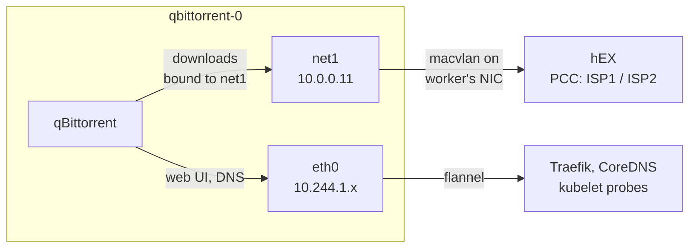

# Networking

One LAN address, 10.0.0.30, fronts every `.internal` name; two apps also have addresses of their own.

## MetalLB, layer 2

MetalLB assigns LoadBalancer addresses from **10.0.0.30–39**, clear of DHCP (.160–.191), reservations and the nodes' .20 and .21.

In layer 2 mode it uses ARP:

1. One node's speaker claims 10.0.0.30 and answers ARP for it with its own MAC.
2. The LAN sends frames for 10.0.0.30 to that node.
3. If the node dies, the other speaker takes the address and sends a gratuitous ARP. A few seconds.

One node carries an address at a time. Traefik's Service uses `externalTrafficPolicy: Local`, so MetalLB announces from the node running Traefik and client addresses survive into the logs.

BGP mode is deferred: on one laptop ECMP buys nothing, and the router already carries the [three-ISP routing](../../home-network/docs/02-routing-and-failover.md).

Talos enforces Pod Security `baseline`; `metallb-system` (host networking, raw sockets) and `monitoring` (node-exporter) are privileged.

## Traefik

One Service on 10.0.0.30, ports 80 and 443, routing by `Host` to each Ingress. ingress-nginx was retired upstream (last release March 2026); Traefik also speaks Gateway API.

## Names

Every app is a plain `<name>.internal`, an explicit record in the router's Terraform pointing at 10.0.0.30:

```hcl
"home.internal"  = { address = "10.0.0.30", comment = "via Traefik (k8s)" }
"qbit.internal"  = { address = "10.0.0.30", comment = "via Traefik (k8s)" }
```

A `*.k8s.internal` regexp record lasted an hour: it put where a thing runs into its name, and a wildcard on all of `.internal` would compete with exact names and turn typos into Traefik 404s.

## Services outside the cluster

pve's web UI and the switch's are Services with **no selector** and a hand-written EndpointSlice ([`apps/lan-proxy/`](../apps/lan-proxy/backends.yaml)):

```yaml
kind: EndpointSlice
metadata:
  name: tplink
  labels:
    kubernetes.io/service-name: tplink
ports:
  - name: http
    port: 80
endpoints:
  - addresses: ["10.0.0.2"]   # the switch
```

To Traefik it is an ordinary Service; `Host` passes through unchanged.

## The catch-all

An Ingress with no host rule, Traefik's lowest priority, redirects anything without a matching name (a bare IP, a stale bookmark) to `https://home.internal`. It cannot proxy, because Homepage refuses unknown `Host` headers.

## Jellyfin: 10.0.0.10

The TV is set up with `10.0.0.10:8096`. MetalLB's second pool, `household`, holds only 10.0.0.10 with `autoAssign: false`, so nothing gets it unasked. Jellyfin's Service asks by name:

```yaml
annotations:
  metallb.io/loadBalancerIPs: 10.0.0.10
```

`jellyfin.internal` reaches it through Traefik.

## qBittorrent: 10.0.0.11 on net1

The router splits downloads across ISP1 and ISP2 by matching **source address 10.0.0.11** ([routing and failover](../../home-network/docs/02-routing-and-failover.md)). A pod's traffic normally leaves as its node, 10.0.0.21, and a MetalLB address only changes where traffic arrives. So the pod gets a second interface, `net1`, on the LAN:



- **Multus** attaches extra networks after flannel sets up `eth0`.
- **macvlan** makes `net1` a virtual NIC on the worker's `eth0` with its own MAC.
- **`media/lan`**, a NetworkAttachmentDefinition. The pod picks address and a fixed MAC, so the router's view never changes:

  ```yaml
  k8s.v1.cni.cncf.io/networks: |
    [{"name": "lan", "interface": "net1",
      "ips": ["10.0.0.11/24"], "mac": "BC:24:11:03:AA:5D"}]
  ```

qBittorrent binds download sockets to `net1` (Options > Advanced > Network interface).

### Source-based routing

```
$ ip rule
0:      from all lookup local
32765:  from 10.0.0.11 lookup 100
32766:  from all lookup main

$ ip route                      # main: the cluster
default via 10.244.1.1 dev eth0
10.244.0.0/16 via 10.244.1.1 dev eth0
10.244.1.0/24 dev eth0 scope link src 10.244.1.88

$ ip route show table 100       # only for traffic from 10.0.0.11
default via 10.0.0.1 dev net1
10.0.0.0/24 dev net1 scope link src 10.0.0.11
```

Packets from 10.0.0.11 use table 100 and leave through `net1`; everything else uses `main`. The `sbr` plugin, chained after macvlan, builds this. Without it the pod would answer kubelet's health checks (from 10.0.0.21) out of `net1`, which cannot reach the node.

### What to know

- **A macvlan cannot reach its own host.** Pods on the worker cannot reach 10.0.0.11; Homepage and health checks use `qbittorrent.media.svc.cluster.local:8090`.
- **The pod needs no privileges.** `sbr` sets up routing at network creation; `baseline` forbids the `NET_ADMIN` the pod would otherwise need ([Incidents](07-incidents.md)).
- **Multus is in every pod's path.** While its daemon on a node is down, new pods there cannot start; running pods are unaffected.
- **Talos ships few CNI plugins.** macvlan, `sbr` and `tuning` (sets the MAC) are copied onto each node by an init container on the Multus DaemonSet, from siderolabs' `install-cni` image.
- **Only qBittorrent's download sockets use 10.0.0.11.** Lose that setting and the split silently stops.

### Checks

```sh
# the pod has its LAN interface and rule
kubectl -n media exec qbittorrent-0 -- ip -4 addr show net1
kubectl -n media exec qbittorrent-0 -- ip rule

# the router sees it and splits it (on the router)
/ip firewall connection print count-only where src-address=10.0.0.11
/ip firewall connection print where src-address=10.0.0.11 connection-mark~"dl-"
```

Healthy: `net1` holds 10.0.0.11, the rule points at table 100, and the router's connections from 10.0.0.11 carry `dl-isp1` and `dl-isp2` in roughly equal numbers.

Configuration: [`lan-network.yaml`](../apps/media/lan-network.yaml), [`qbittorrent.yaml`](../apps/media/qbittorrent.yaml), [`jellyfin.yaml`](../apps/media/jellyfin.yaml), [`multus/`](../infrastructure/controllers/multus/kustomization.yaml).
