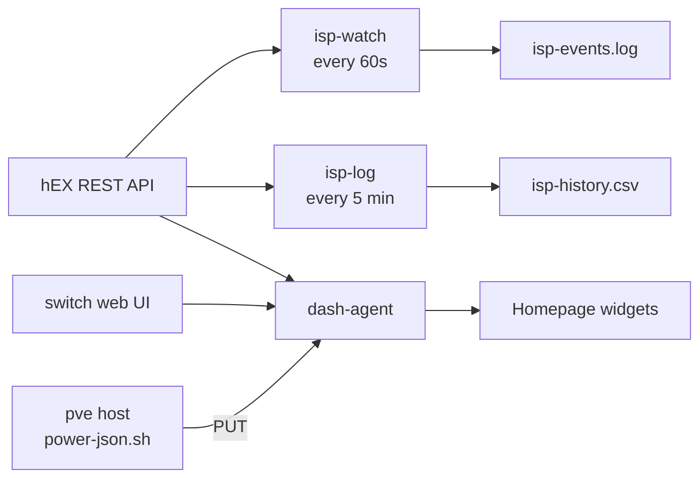

# Apps

Homepage, the `homenet` jobs behind the dashboard and the ISP outage record, and the media apps. Prometheus is on [Monitoring](05-monitoring.md).

## Homepage

[Homepage](https://gethomepage.dev) at `https://home.internal`: household services, the Proxmox host's resources, router and switch state, and a Cluster group reading pod status from the Kubernetes API (hence a ServiceAccount and a read-only ClusterRole).

- **Chart:** bjw-s `app-template`, which runs whatever image it is given (v2.4.0). The community chart ships v1.2.0. A small script makes the theme follow the OS light/dark setting.
- **Allowed hosts:** Homepage answers **400** to any `Host` not in `HOMEPAGE_ALLOWED_HOSTS`. List every name a request can arrive with, including the in-cluster name the health check uses.
- **Secrets at runtime:** widget credentials are `HOMEPAGE_VAR_*` values in [`secret.sops.yaml`](../apps/homepage/secret.sops.yaml), substituted into the config when Homepage starts. The Proxmox, Jellyfin, qBittorrent and Grafana widgets log in with them.

## homenet

| | Runs | Does |
|---|---|---|
| `dash-agent` | Deployment | serves `wan.json` and `switch.json`, running a collector when Homepage asks, with a floor so an open tab cannot hammer the router or the switch; keeps the last good `power.json`; republishes the controller's mode at `/metrics` |
| `isp-watch` | CronJob, every minute | notices WAN state changes and appends them to `isp-events.log` |
| `isp-log` | CronJob, every 5 minutes | per-ISP loss and throughput from the router's counters, `isp-history.csv` |
| `backup` | CronJob, nightly | restic snapshot of the volume ([State and secrets](06-state-and-secrets.md)) |

`power.json` (battery, fan, CPU temperature) is readable only on the Proxmox host, so the host PUTs it to `http://dash.internal/power.json` every minute; `dash-agent` keeps it only if it looks like a real reading.

`isp-events.log` is the dropout record used as evidence against a provider ([ISP0 optical fault](../../home-network/docs/postmortems/isp0-optical-fault.md)). It must not be lost, and nothing false may be written into it.



### Scripts and image

Shell scripts and one Python HTTP server in [`apps/homenet/scripts/`](../apps/homenet/scripts/), shipped as a ConfigMap.

The scripts parse router output with `awk`, and `awk` implementations differ. So the image ([`images/homenet-agent`](../images/homenet-agent/Dockerfile)) is **Debian 13** with Python 3.13, curl and `mawk`, the toolset the scripts were written against, rather than Alpine's busybox. It holds only tools, is built by GitHub Actions when `VERSION` changes, and runs as `nobody` with a read-only root filesystem.

### The pre-deploy test

Before deploying, I ran all four scripts on the Proxmox host against the real router and switch, writing to scratch logs. Every router call returned **401**, and `isp-watch` wrote:

```
2026-10-09T07:02:58+00:00  CRIT    ALL WANS DOWN
```

All three ISPs were up. The router's `homepage` account accepts logins only from listed addresses, and the worker's 10.0.0.21 (the source of all pod traffic to the router) was not listed. The fix was one line on the router. `isp-watch` reads "cannot ask the router" as "no WAN is up".

### Deploying without two writers

I deployed the CronJobs **suspended**, loaded the existing history and counter state into the volume, then enabled them, so two copies never wrote the same log or raced the same counter baselines. `isp-log` measures loss as a difference between cumulative counters, so a pause makes the next row cover a longer interval without losing data.

## Media apps

Jellyfin and qBittorrent run in `media`.

- **Library:** pve exports `/mnt/pve/media` over NFS; one ReadWriteMany claim, `media/library`, serves both. Jellyfin mounts it read-only at `/media`, qBittorrent mounts `downloads` at `/downloads`. The export maps every client user to uid **100000**, so pod- and host-written files share an owner.
- **State:** Jellyfin's database and metadata and qBittorrent's download list and resume data sit on a local-path volume on the worker.
- **Addresses:** Jellyfin 10.0.0.10, qBittorrent 10.0.0.11; see [Networking](02-networking.md).
