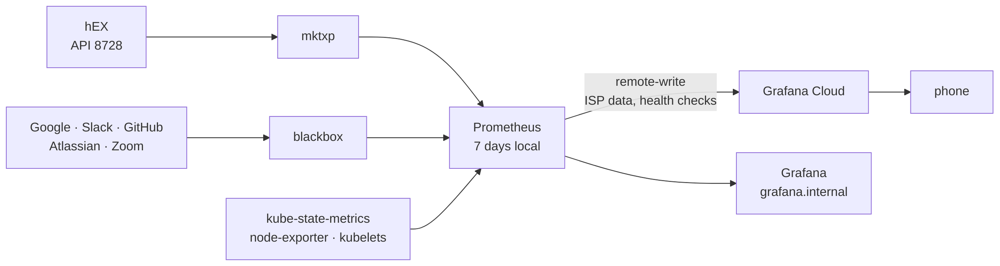

# Monitoring

Prometheus in the cluster watches the network and the household. ISP data and health checks go to Grafana Cloud, which alerts a phone and works when the cluster doesn't; the cluster's own metrics stay local.

## The pieces



| | Runs | Does |
|---|---|---|
| Prometheus Operator | Deployment | turns the objects below into Prometheus config and reloads it on change |
| Prometheus | StatefulSet, one replica | scrapes, evaluates rules, remote-writes to Grafana Cloud |
| `mktxp` | Deployment | the router's interfaces, routes and netwatch probes, from its binary API |
| `blackbox` | Deployment | HTTP and DNS checks: external services (Google, Slack, GitHub, Atlassian, Zoom) and everything on the household dashboard |
| kube-state-metrics | Deployment | state of every Kubernetes object |
| node-exporter | DaemonSet | each node's CPU, memory, disk, network |
| Grafana | Deployment | the chart's default Kubernetes dashboards only |

All from the `kube-prometheus-stack` chart ([`apps/monitoring/kube-prometheus-stack.yaml`](../apps/monitoring/kube-prometheus-stack.yaml)) except mktxp and blackbox, plain manifests beside it. No Alertmanager; Grafana Cloud alerts.

## Config as objects

No Prometheus config file; scrapes and rules are objects beside their exporter:

| Object | For | In |
|---|---|---|
| `ServiceMonitor/mktxp` | the router exporter, every 30 s | `mktxp.yaml` |
| `Probe` × 5, one per service | external services, every 60 s | `blackbox.yaml` |
| `Probe` × 7, one per module | the household health checks | `health.yaml` |
| `PrometheusRule/wan-rules` | WAN recording and alert rules | `wan-rules.yaml` |
| `PrometheusRule/household-health` | one alert for a failing health check | `health.yaml` |
| `PrometheusRule/home-rules` | backup age and `BackupStale` | `home-rules.yaml` |
| `ServiceMonitor/dash-agent` | the hEX controller's mode and run-count | `apps/homenet/servicemonitor.yaml` |

Prometheus selects them from every namespace. The operator loads changes without a restart, and its webhook rejects a `PrometheusRule` that does not parse.

The CRDs install separately with the controllers (`infrastructure/controllers/prometheus-operator-crds`): the monitoring app ships objects of those kinds, which can't apply before their CRD exists ([Architecture](01-architecture.md)). Keep both charts on the same operator version.

## Health checks

blackbox probes everything on the household dashboard as job `household-health` ([`health.yaml`](../apps/monitoring/health.yaml)):

| Group | Checks |
|---|---|
| household | Jellyfin by the address the TV uses, answering `Healthy`; qBittorrent through its Service |
| via-traefik | every app by its `.internal` name (tests DNS, Traefik, certificate and app) |
| network | pve's web UI by address, the switch every 5 minutes, the router's resolver |
| cluster | Homepage's pod, bypassing Traefik |

Each is a remote-written `probe_success` series. Homepage's *Health checks* tile shows the failing count; `HouseholdCheckFailing` fires after a check fails for five minutes.

Modules are in [`blackbox.yml`](../apps/monitoring/blackbox.yml), a hash-named ConfigMap, so an edit rolls the pod. The resolver check expects `pve.internal` = 10.0.0.3, a name proxies don't move ([Incidents](07-incidents.md)).

## What leaves the house

Remote-write matches on job and metric name:

| Sent | Why |
|---|---|
| job `mktxp` | the router, including its `up`, which `RouterUnreachable` needs |
| job `blackbox-work` | external services, over the live path |
| job `household-health` | outage history of every household service |
| `isp:*` | the WAN and controller recording rules every network alert uses |
| `home:*` | household state that must alert from outside, such as backup age |

About 1,000 series. The cluster's ~80,000 (API server request histograms alone: 53,000) stay local; the free tier is 10,000.

Series identity stays stable across pod restarts:

- The mktxp and blackbox scrapes drop the operator's `pod`, `namespace` and similar labels; mktxp's `instance` is fixed at `mktxp:49090`.
- The only external label is `site: home`; the chart's `prometheus` and `prometheus_replica` labels are off.

The queue holds **2 h**, so an uplink outage backfills.

## What stays local

Seven days on a 5 GiB volume. The chart's Kubernetes rules (crash loops, node pressure, filling volumes) show only on Prometheus's Alerts page; routing them, and a dead-man's switch for `Watchdog`, are [next steps](../README.md).

Disabled because they fire permanently here:

- `KubeCPUOvercommit`, `KubeMemoryOvercommit`: ask whether pods fit if the largest node dies; surviving node loss is a non-goal.
- `PrometheusNotConnectedToAlertmanagers`: no Alertmanager by design.

Talos binds controller-manager, scheduler, etcd and kube-proxy metrics to localhost; those scrapes and rules are off.

## Grafana

https://grafana.internal shows the cluster's dashboards only. The LAN views without login; editing needs the admin password in `grafana-admin.sops.yaml` (`sops -d`). No volume: dashboards are chart ConfigMaps, so a restart loses only UI edits.

The house's dashboards (ISP, *Household health*) live in Grafana Cloud; *Household health* is kept for import at [`grafana-cloud/household-health.json`](../apps/monitoring/grafana-cloud/household-health.json).

## Access

https://prometheus.internal and https://grafana.internal go through Traefik. An `ipAllowList` excludes the guest pool, 10.0.0.160/27: the operator always enables the lifecycle API, so anyone reaching the UI could `POST /-/quit`. Traefik sees real client addresses (`externalTrafficPolicy: Local`).

## Privileges

- node-exporter needs host mounts and host network and PID namespaces, which `baseline` forbids, so `monitoring` is privileged (as is `metallb-system`). Anything deployed there gets the same.
- The router's `mktxp` account accepts 10.0.0.20/31; the exporter can land on either node.

## Adding something to watch

Scrape a Service from the app's own directory:

```yaml
apiVersion: monitoring.coreos.com/v1
kind: ServiceMonitor
metadata:
  name: <app>
spec:
  selector:
    matchLabels: {app: <app>}   # the Service needs this label
  endpoints:
    - port: metrics
```

- Health check: a target in `health.yaml`'s `Probe`, or a new `Probe` per module; it reaches Grafana Cloud automatically.
- Rule: a `PrometheusRule`.
- Anything else for Grafana Cloud: extend the remote-write filter in `kube-prometheus-stack.yaml`.

Verify at https://prometheus.internal/targets.

## Limits

- No outside watcher: if the cluster is down, nothing alerts ([Architecture](01-architecture.md)).
- One replica on a local volume; losing it loses up to seven days of cluster metrics.
